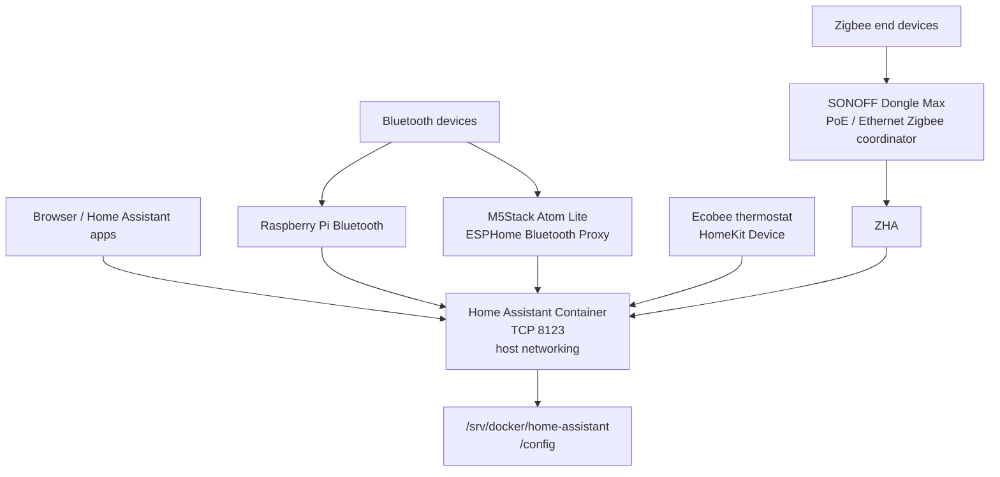

# Home Assistant

Home Assistant is the home automation platform for XRP Homelab. It runs as Home Assistant Container on the Raspberry Pi 5 and keeps its persistent configuration under `/srv/docker/home-assistant`.

The deployment is intentionally local-first where the device protocol supports it. Bluetooth devices can use the Raspberry Pi adapter or an ESPHome Bluetooth proxy, Zigbee uses a network-attached SONOFF Dongle Max through ZHA, and the Ecobee thermostat uses a local HomeKit Device integration.

## Purpose

Home Assistant provides one local automation and control layer for my multi-vendor smart-home integrations.

The repository documents the platform, network adapters, persistence, recovery procedure, and representative integration paths.

## Deployment

| Item | Value |
| --- | --- |
| Platform | Raspberry Pi 5 (ARM64) |
| Deployment method | Docker Compose |
| Installation method | Home Assistant Container |
| Image | `ghcr.io/home-assistant/home-assistant:2026.9.3` |
| Installed version | `2026.9.3` |
| Compose project | `home-assistant` |
| Container | `homeassistant` |
| Database | SQLite |
| Network mode | Host |
| Web listener | `8123/tcp` |
| Persistent storage | `/srv/docker/home-assistant` |

## Architecture



Home Assistant uses the Raspberry Pi's onboard Bluetooth adapter and a network-connected M5Stack Atom Lite Bluetooth proxy at the same time. The proxy extends BLE coverage without attaching another USB radio to the Raspberry Pi.

The SONOFF Dongle Max is a PoE/Ethernet Zigbee coordinator on the Homelab network. Home Assistant auto-discovered it and configured ZHA using the Silicon Labs `ezsp` radio type over a TCP socket.

The Ecobee thermostat is paired through Home Assistant's HomeKit Device integration. This path is local over the LAN and does not require an Apple Home hub for Home Assistant control.

## Directory Structure

Live deployment definition:

```text
/opt/stacks/home-assistant/
└── compose.yaml
```

Persistent Home Assistant state:

```text
/srv/docker/home-assistant/
├── .storage/
├── automations.yaml
├── blueprints/
├── configuration.yaml
├── home-assistant_v2.db
├── scenes.yaml
├── scripts.yaml
├── secrets.yaml
└── ...
```

Repository copy:

```text
stacks/
└── home-automation/
    └── home-assistant/
        ├── compose.yaml
        └── README.md
```

## Docker Compose

Local deployment definition:

```text
/opt/stacks/home-assistant/compose.yaml
```

Deployed configuration:

```yaml
services:
  homeassistant:
    image: ghcr.io/home-assistant/home-assistant:2026.9.3
    container_name: homeassistant
    restart: unless-stopped
    stop_grace_period: 60s
    network_mode: host

    cap_add:
      - NET_ADMIN
      - NET_RAW

    volumes:
      - /srv/docker/home-assistant:/config
      - /etc/localtime:/etc/localtime:ro
      - /run/dbus:/run/dbus:ro

    environment:
      TZ: America/Denver
```

Home Assistant's generic Container example uses `privileged: true`. This deployment does not. The verified Bluetooth configuration uses the narrower `NET_ADMIN` and `NET_RAW` capabilities plus the read-only D-Bus mount required by current Home Assistant Container Bluetooth guidance.

## Ports

| Host Port | Container Port | Purpose |
| ---: | ---: | --- |
| `8123/tcp` | Host network | Home Assistant web interface and API |

## Persistent Storage

| Host Path | Container Path | Mode | Contents |
| --- | --- | --- | --- |
| `/srv/docker/home-assistant` | `/config` | Read/write | Home Assistant configuration, SQLite database, integration state, automations, scripts, secrets, backups, and runtime state |
| `/etc/localtime` | `/etc/localtime` | Read-only | Host time configuration |
| `/run/dbus` | `/run/dbus` | Read-only | Host D-Bus access for Bluetooth through BlueZ |

The `/config` bind mount contains the SQLite database and `.storage` integration state.

Back up the entire `/srv/docker/home-assistant` tree rather than selecting individual configuration files.

## Networking

Home Assistant uses host networking. This is intentional because local smart-home protocols depend heavily on LAN discovery, multicast, mDNS, and direct device connections.

Current connectivity paths include:

- Raspberry Pi Bluetooth through host BlueZ and D-Bus.
- M5Stack Atom Lite through ESPHome over the LAN, acting as a Bluetooth proxy.
- SONOFF Dongle Max over wired PoE/Ethernet, acting as the ZHA Zigbee coordinator.
- Ecobee through the HomeKit Device integration over the LAN.

The Dongle Max uses wired Ethernet rather than Wi-Fi for the coordinator connection. SONOFF recommends Ethernet when using its TCP-based ZHA connection because coordinator reliability depends on stable network connectivity.

For security, there is no public Internet exposure. Remote access uses the homelab's existing private remote-access layer rather than a Home Assistant port-forward in this stack.

## Configuration

| Setting | Value | Reason |
| --- | --- | --- |
| Image | `ghcr.io/home-assistant/home-assistant:2026.9.3` | Pins the verified running release |
| `TZ` | `America/Denver` | Matches the host deployment |
| Network mode | `host` | Supports LAN discovery and local smart-home protocols |
| `NET_ADMIN` | Added | Required for full Bluetooth adapter management in Home Assistant Container |
| `NET_RAW` | Added | Required for full Bluetooth adapter management in Home Assistant Container |
| D-Bus | `/run/dbus:/run/dbus:ro` | Provides container access to host BlueZ |
| Stop grace period | `60s` | Allows Home Assistant time to shut down cleanly |
| Bluetooth proxy | M5Stack Atom Lite / ESPHome | Extends BLE coverage over the LAN |
| Zigbee coordinator | SONOFF Dongle Max / ZHA | Provides a dedicated network-attached Zigbee coordinator |
| ZHA radio type | `ezsp` | Matches the Dongle Max Silicon Labs radio |
| ZHA transport | `socket://<DONGLE-MAX-IP>:6638` | Ethernet coordinator path |
| HomeKit example | Ecobee thermostat | Provides a local LAN integration example |

## Initial Deployment

This procedure assumes Docker Engine and Docker Compose are already installed on the XRP Homelab host.

### 1. Check prerequisites and conflicts

```bash
uname -m
docker --version
docker compose version

sudo ss -ltnp | grep ':8123 ' \
  || echo "Port 8123 is available"

docker ps -a --filter name=homeassistant

ls -ld \
  /opt/stacks/home-assistant \
  /srv/docker/home-assistant \
  2>/dev/null || true

ls -l /run/dbus/system_bus_socket
systemctl is-active bluetooth
bluetoothctl --version
```

The host should report `aarch64`. Port `8123` should be free before the first deployment, and the D-Bus socket should exist when onboard Bluetooth is required.

### 2. Create deployment directories

```bash
sudo install -d -m 0755 /opt/stacks/home-assistant
sudo install -d -m 0755 /srv/docker/home-assistant

ls -ld /opt/stacks/home-assistant /srv/docker/home-assistant
```

### 3. Install the Compose definition

Place the repository's `compose.yaml` at:

```text
/opt/stacks/home-assistant/compose.yaml
```

### 4. Validate

```bash
cd /opt/stacks/home-assistant
docker compose config
```

Review the resolved image, timezone, host networking, capabilities, bind mounts, restart policy, and stop grace period before continuing.

### 5. Pull the image

```bash
docker compose pull
```

### 6. Deploy

```bash
docker compose up -d
docker compose ps
docker compose logs --tail=100
```

Verify the listener and HTTP response:

```bash
sudo ss -ltnp | grep ':8123 '

curl -s -o /dev/null \
  -w 'HTTP status: %{http_code}\n' \
  http://127.0.0.1:8123/
```

### 7. Verify persistence

```bash
sudo ls -lah /srv/docker/home-assistant
sudo du -sh /srv/docker/home-assistant
```

Complete first-run onboarding in the web interface, then perform a controlled restart:

```bash
cd /opt/stacks/home-assistant
docker compose restart
```

After Home Assistant finishes starting, confirm the owner account, areas, integrations, and other important state remain present.

### 8. Configure Bluetooth

The Compose definition already provides the D-Bus mount and Linux capabilities used by the Raspberry Pi's onboard Bluetooth adapter.

In Home Assistant:

```text
Settings
-> Connectivity
-> Bluetooth
```

Verify that the local Raspberry Pi adapter appears.

For extended BLE coverage, flash the M5Stack Atom Lite with the ESPHome Bluetooth Proxy ready-made project, connect it to the local network, and add the resulting ESPHome device to Home Assistant.

### 9. Configure Zigbee

Connect the SONOFF Dongle Max to wired Ethernet/PoE and place it on the Homelab network. Configure the Dongle Max web-console password locally and update it to a stable firmware release before adding it to Home Assistant.

Home Assistant may auto-discover the coordinator. The verified deployment uses ZHA with:

```text
Radio type: ezsp
Transport:  socket://<DONGLE-MAX-IP>:6638
```

If manual configuration is required, SONOFF documents TCP setup with port speed `115200` and software flow control.

After ZHA creates the Zigbee network, verify the coordinator under:

```text
Settings
-> Connectivity
-> Zigbee
-> Network information
```

### 10. Pair the Ecobee through HomeKit Device

Use Home Assistant's **HomeKit Device** integration, not HomeKit Bridge.

Put the Ecobee into HomeKit pairing mode, allow Home Assistant to discover it on the LAN, and enter the pairing code only in Home Assistant.

The verified integration provides local thermostat control over the LAN.

If the thermostat and Home Assistant are separated by VLANs, HomeKit discovery may require an mDNS reflector/proxy and appropriate inter-VLAN firewall policy.

### 11. Verify in Portainer

Confirm Portainer automatically detects the Compose-created container and labels:

```text
Compose project: home-assistant
Service:         homeassistant
Working dir:     /opt/stacks/home-assistant
```

## Access

Local web interface:

```text
http://<PI-IP>:8123
```

Home Assistant is also reachable through the homelab's existing tailscale network.

The stack does not define public Internet exposure or port forwarding.

## Portainer

The service is deployed through Docker Compose and appears automatically in Portainer.

Verified Portainer metadata includes:

```text
Project:    home-assistant
Service:    homeassistant
Config:     /opt/stacks/home-assistant/compose.yaml
WorkingDir: /opt/stacks/home-assistant
```

Portainer is used for status, logs, resource inspection, and routine operational visibility. The Compose file under `/opt/stacks/home-assistant` remains the deployment source of truth.

## Backup

Home Assistant Container supports native encrypted backups. Local native backups are stored under:

```text
/srv/docker/home-assistant/backups/
```

Set up automatic backups under:

```text
Settings
-> System
-> Backups
```

Download and protect the Home Assistant backup emergency kit. Keep at least one recent backup on another system; a backup stored only on the Raspberry Pi does not protect against loss of that host or disk.

The primary XRP Homelab filesystem backup scope is:

```text
/srv/docker/home-assistant
```

It includes configuration, `.storage`, the SQLite database, integration state, automations, scripts, secrets, and native backup archives.

For a consistent pre-upgrade cold backup:

```bash
cd /opt/stacks/home-assistant

docker compose stop

sudo mkdir -p /srv/backups/home-assistant

sudo tar -czf \
  /srv/backups/home-assistant/home-assistant-$(date +%Y-%m-%d-%H%M%S).tar.gz \
  /opt/stacks/home-assistant/compose.yaml \
  /srv/docker/home-assistant

docker compose start
```

Copy the resulting archive off the Raspberry Pi.

ZHA automatically creates Zigbee network backups. A manual ZHA network backup can also be created from Zigbee Network Settings before coordinator replacement or major changes.

External radio devices are separate hardware dependencies:

- The M5Stack Atom Lite must remain powered, network-connected, and configured as an ESPHome Bluetooth proxy.
- The SONOFF Dongle Max must remain powered, reachable over Ethernet, and configured as the Zigbee coordinator.
- Their administration credentials and Wi-Fi/API secrets are not stored in GitHub.

## Restore

### Clean-host filesystem restore

1. Install Docker Engine and Docker Compose on the replacement Raspberry Pi.
2. Restore `/srv/docker/home-assistant` from the selected backup.
3. Create the deployment directory:

   ```bash
   sudo install -d -m 0755 /opt/stacks/home-assistant
   ```

4. Place the repository's `compose.yaml` at:

   ```text
   /opt/stacks/home-assistant/compose.yaml
   ```

5. Confirm BlueZ and D-Bus are available if onboard Bluetooth is required:

   ```bash
   systemctl is-active bluetooth
   ls -l /run/dbus/system_bus_socket
   ```

6. Confirm the external adapters are reachable:
   - M5Stack Atom Lite on the LAN.
   - SONOFF Dongle Max on the LAN/PoE network.

7. Validate:

   ```bash
   cd /opt/stacks/home-assistant
   docker compose config
   ```

8. Pull:

   ```bash
   docker compose pull
   ```

9. Deploy:

   ```bash
   docker compose up -d
   docker compose ps
   docker compose logs --tail=100
   ```

10. Verify:

   ```bash
   curl -s -o /dev/null \
     -w 'HTTP status: %{http_code}\n' \
     http://127.0.0.1:8123/
   ```

11. Verify the Bluetooth adapters, ESPHome proxy, ZHA coordinator, HomeKit devices, automations, and dashboard state.

### Native Home Assistant backup restore

A Home Assistant native backup can also be restored during onboarding or from the Backups page. Keep the backup emergency kit available because current Home Assistant backups are encrypted by default.

After a native restore, verify the external radio paths separately. Restoring Home Assistant state does not power, reconnect, or reconfigure external network hardware.

## Update Procedure

Home Assistant is pinned to an explicit Core image version. Do not change the image tag until the target release has been selected and its release notes reviewed.

Before an update:

1. Create a current Home Assistant backup and copy it off-host.
2. Read every Home Assistant release note between the installed version and the target version, including backward-incompatible changes.
3. Record the currently deployed image tag.
4. Confirm the M5Stack Bluetooth proxy and SONOFF Zigbee coordinator are healthy.

Edit:

```text
/opt/stacks/home-assistant/compose.yaml
```

Change only the pinned image tag, then:

```bash
cd /opt/stacks/home-assistant

docker compose config
docker compose pull
docker compose up -d

docker compose ps
docker compose logs --tail=150

curl -s -o /dev/null \
  -w 'HTTP status: %{http_code}\n' \
  http://127.0.0.1:8123/
```

After the update, review **Settings -> System -> Repairs** and **Settings -> System -> Logs**.

Verify at minimum:

- Web interface and authentication.
- Raspberry Pi Bluetooth.
- ESPHome Bluetooth proxy.
- ZHA coordinator.
- A representative Bluetooth device.
- A representative Zigbee device when one is deployed.
- Ecobee HomeKit control.
- Automations and persistence.

If the update introduces a regression, restore the pre-update backup rather than repeatedly changing unrelated settings.

## Security Considerations

`network_mode: host` gives Home Assistant direct access to the Raspberry Pi network namespace. It is used because local discovery protocols and smart-home integrations depend on direct LAN access. This also gives Home Assistant broader network visibility than an ordinary bridge-network container.

The container is not run with `privileged: true`. Instead, Bluetooth management uses only:

```text
NET_ADMIN
NET_RAW
```

The read-only `/run/dbus` mount still gives the container access to host D-Bus/BlueZ and should be treated as security-sensitive.

The Compose file does not publish Home Assistant to the public Internet.

## Troubleshooting

### Web interface is unavailable

**Symptom**

The container is running but `http://<PI-IP>:8123` does not load.

**Resolution**

```bash
cd /opt/stacks/home-assistant

docker compose ps
docker compose logs --tail=150

sudo ss -ltnp | grep ':8123 '

curl -v http://127.0.0.1:8123/
```

Because host networking is used, there is no Docker `ports:` mapping to inspect.

### Bluetooth adapter is missing or degraded

**Symptom**

The Raspberry Pi adapter is unavailable, Bluetooth devices update unreliably, or Home Assistant reports missing Bluetooth management permissions.

**Resolution**

Verify host Bluetooth, D-Bus, and the deployed capabilities:

```bash
systemctl is-active bluetooth
bluetoothctl show
ls -l /run/dbus/system_bus_socket

docker inspect homeassistant \
  --format 'CapAdd={{json .HostConfig.CapAdd}}'
```

The Compose definition should contain `NET_ADMIN`, `NET_RAW`, and the read-only `/run/dbus` mount. Recreate the container after changing capabilities:

```bash
cd /opt/stacks/home-assistant
docker compose up -d
```

### ESPHome Bluetooth proxy is unavailable

**Symptom**

Devices near the remote proxy stop updating while devices near the Raspberry Pi still work.

**Resolution**

Verify the M5Stack Atom Lite has power, Wi-Fi connectivity, and a reachable ESPHome API connection. Check the ESPHome integration in Home Assistant before changing the Docker deployment.

### ZHA coordinator is unavailable

**Symptom**

Zigbee becomes unavailable or Home Assistant reports coordinator connection errors.

**Resolution**

Verify the SONOFF Dongle Max has PoE/Ethernet connectivity and that its reserved address is reachable.

```bash
ping <DONGLE-MAX-IP>
nc -vz <DONGLE-MAX-IP> 6638
```

Then inspect Home Assistant logs:

```bash
cd /opt/stacks/home-assistant

docker compose logs --tail=200 \
  | grep -Ei 'zha|zigpy|ember|ezsp|zigbee|6638|error|warning'
```

Do not erase the Zigbee network as a first troubleshooting step. ZHA network backups should be preserved before coordinator replacement or migration.

### HomeKit device is not discovered across VLANs

**Symptom**

A HomeKit accessory is reachable on another VLAN but does not appear for pairing.

**Cause**

HomeKit IP discovery uses mDNS. Cross-VLAN discovery normally requires an mDNS reflector/proxy plus firewall rules that permit the actual device connection.

**Resolution**

Verify the gateway's mDNS proxy/reflector scope and the firewall path between Home Assistant and the accessory. Do not factory-reset or remove a working HomeKit pairing merely to troubleshoot multicast discovery.

### `DISABLE_JEMALLOC` warning appears

**Symptom**

Startup logs report that `DISABLE_JEMALLOC` is set but has no effect because the image uses mimalloc.

**Cause**

An obsolete allocator workaround remained in the Compose environment during the initial deployment.

**Resolution**

Remove the unused variable and recreate the container:

```bash
sudo sed -i '/DISABLE_JEMALLOC:/d' \
  /opt/stacks/home-assistant/compose.yaml

cd /opt/stacks/home-assistant
docker compose config
docker compose up -d
```

The verified current Compose definition does not include `DISABLE_JEMALLOC`.

## References

- Home Assistant Container installation: https://www.home-assistant.io/installation/alternative
- Home Assistant Container common tasks: https://www.home-assistant.io/common-tasks/container/
- Home Assistant backups: https://www.home-assistant.io/common-tasks/general/backups/
- Home Assistant Bluetooth: https://www.home-assistant.io/integrations/bluetooth/
- Home Assistant HomeKit Device: https://www.home-assistant.io/integrations/homekit_controller/
- Home Assistant ZHA: https://www.home-assistant.io/integrations/zha/
- ESPHome Bluetooth Proxy: https://esphome.io/components/bluetooth_proxy/
- SONOFF Dongle Max ZHA guide: https://dongle.sonoff.tech/guide/dongle-m/donglem_connecting_to_home_assistant_via_zha/
- Home Assistant Core releases: https://github.com/home-assistant/core/releases
