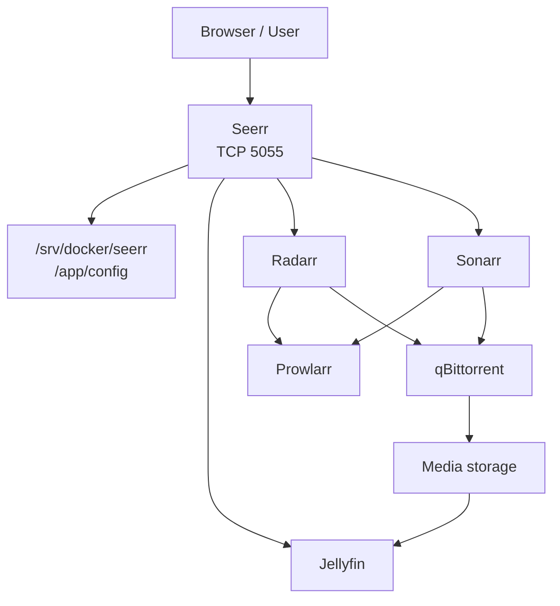

# Seerr

Seerr is the media discovery and request application for XRP Homelab. It runs on the Raspberry Pi 5 through Docker Compose and connects the request workflow to Jellyfin, Radarr, and Sonarr.

## Purpose

Seerr gives users one interface for discovering and requesting movies and TV series without requiring direct access to Radarr or Sonarr.

The verified request path is:

```text
Seerr
  ├── movie request ──> Radarr ──┐
  └── series request ─> Sonarr ──┤
                                 ├──> Prowlarr / indexers
                                 └──> qBittorrent
                                           |
                                           v
                                      media storage
                                           |
                                           v
                                        Jellyfin
```

A live request was verified end to end: Seerr routed it to the appropriate Arr application, qBittorrent began downloading when matching media was available, and the completed media appeared in Jellyfin.

> [!WARNING]
> **Legal notice:** This service is documented for educational and personal homelab use only. Use it only to manage, request, index, or download media that you legally own or are otherwise authorized to access. The operator is responsible for complying with applicable copyright laws, licenses, and service terms.

## Deployment

| Item | Value |
| --- | --- |
| Platform | Raspberry Pi 5 (ARM64) |
| Deployment method | Docker Compose |
| Image | `ghcr.io/seerr-team/seerr:v3.5.0` |
| Installed version | `3.5.0` |
| Compose project | `seerr` |
| Container | `seerr` |
| Database | SQLite |
| Persistent storage | `/srv/docker/seerr` |
| Web port | `5055/tcp` |

The image pulled successfully on the ARM64 host. The container has been verified healthy, survives a controlled restart with its settings intact, and is visible in Portainer.

As of 2026-11-19, upstream `v3.5.1` is available. The homelab remains pinned to the verified `v3.5.0` deployment until that update is performed and tested separately.

## Architecture



Seerr uses Docker's default Compose bridge network. Jellyfin, Radarr, and Sonarr are configured in the Seerr web interface. Prowlarr and qBittorrent remain downstream of Radarr/Sonarr.

## Directory Structure

Deployment definition:

```text
/opt/stacks/seerr/
└── compose.yaml
```

Persistent data:

```text
/srv/docker/seerr/
├── cache/
├── db/
├── logs/
├── settings.json
└── settings.old.json
```

Repository copy:

```text
stacks/
└── media/
    └── seerr/
        ├── compose.yaml
        └── README.md
```

## Docker Compose

Local deployment definition:

```text
/opt/stacks/seerr/compose.yaml
```

Deployed configuration example:

```yaml
services:
  seerr:
    image: ghcr.io/seerr-team/seerr:v3.5.0
    container_name: seerr
    init: true
    environment:
      TZ: America/Denver
      PORT: "5055"
    ports:
      - "5055:5055"
    volumes:
      - /srv/docker/seerr:/app/config
    healthcheck:
      test: wget --no-verbose --tries=1 --spider http://localhost:5055/api/v1/settings/public || exit 1
      start_period: 20s
      timeout: 3s
      interval: 15s
      retries: 3
    security_opt:
      - no-new-privileges
    cap_drop:
      - ALL
    restart: unless-stopped
```

## Ports

| Host Port | Container Port | Protocol | Purpose |
| ---: | ---: | --- | --- |
| `5055` | `5055` | TCP | Seerr web interface and API |

## Persistent Storage

| Host Path | Container Path | Contents |
| --- | --- | --- |
| `/srv/docker/seerr` | `/app/config` | SQLite database, settings, integration configuration, cache, logs, and application state |

The host directory is owned by UID/GID `1000:1000`, matching the upstream container's `node` user.

Seerr stores UI settings in `settings.json`. User accounts, requests, blocklist data, and other application state are stored in the SQLite database below `db/`.

## Networking

The Compose project uses the default network:

```text
seerr_default
```

TCP `5055` is published on the Raspberry Pi.

Jellyfin, Radarr, and Sonarr must be configured with addresses reachable from inside the Seerr container. `localhost` and `127.0.0.1` inside Seerr refer to the Seerr container itself.

The deployment does not use host networking, privileged mode, Docker socket access, or host-device mappings.

## Configuration

| Setting | Value | Reason |
| --- | --- | --- |
| Image | `ghcr.io/seerr-team/seerr:v3.5.0` | Pins the verified running version |
| `TZ` | `America/Denver` | Matches the homelab timezone |
| `PORT` | `5055` | Makes the listener explicit |
| Config mount | `/srv/docker/seerr:/app/config` | Gives persistent state an explicit host path |
| `init` | `true` | Provides the init process expected by the container deployment |
| `no-new-privileges` | Enabled | Prevents privilege escalation |
| Linux capabilities | `ALL` dropped | Reduces container privileges |
| Restart policy | `unless-stopped` | Matches XRP Homelab policy |
| Jellyfin | Connected | Library synchronization verified |
| Radarr | Connected, default | Handles movie requests |
| Sonarr | Connected, default | Handles series requests |

API keys remain in Seerr's persistent application configuration and are not committed to GitHub.

## Initial Deployment

This procedure assumes Docker Engine and Docker Compose are already installed on the XRP Homelab host.

### 1. Check prerequisites and conflicts

```bash
uname -m
sudo ss -ltnp | grep ':5055 ' || echo "Port 5055 is free"

docker ps -a   --format 'table {{.Names}}\t{{.Image}}\t{{.Ports}}'   | grep -Ei 'seerr|overseerr|jellyseerr'   || echo "No existing Seerr-family containers found"

ls -ld /opt/stacks/seerr /srv/docker/seerr 2>/dev/null   || echo "Seerr directories do not exist yet"
```

The host should report `aarch64`. If an existing Seerr, Jellyseerr, or Overseerr deployment contains important data, back it up before replacing it.

### 2. Create deployment directories

```bash
sudo mkdir -p /opt/stacks/seerr
sudo mkdir -p /srv/docker/seerr
sudo chown 1000:1000 /srv/docker/seerr
```

Verify:

```bash
ls -ld /opt/stacks/seerr /srv/docker/seerr
```

### 3. Install the Compose definition

Copy the repository's `compose.yaml` to:

```text
/opt/stacks/seerr/compose.yaml
```

### 4. Validate

```bash
cd /opt/stacks/seerr
docker compose config
```

Resolve validation errors before continuing.

### 5. Pull the image

```bash
docker compose pull
```

The successful pull on the Raspberry Pi is the practical ARM64 compatibility check.

### 6. Deploy

```bash
docker compose up -d
docker compose ps
docker compose logs --tail=100
```

Wait for startup, then confirm health:

```bash
sleep 20
docker compose ps
```

### 7. Verify HTTP and persistence

```bash
curl -I http://127.0.0.1:5055
ls -lah /srv/docker/seerr
stat -c '%U:%G %u:%g %a %n' /srv/docker/seerr
```

A new installation can redirect to `/setup`. A configured deployment redirects to `/login`.

### 8. Complete first-run setup

Open:

```text
http://<PI-IP>:5055
```

Connect Jellyfin, then add Radarr and Sonarr under Seerr's service settings.

For the normal single-instance deployment:

- mark Radarr as the default movie server
- mark Sonarr as the default series server
- leave the 4K server options disabled unless separate 4K instances exist
- select the intended quality profile and root folder
- enable scan
- enable automatic search when approved requests should start searching immediately

### 9. Verify the request workflow

Submit a controlled movie or series request and confirm:

1. Seerr sends it to the appropriate default Radarr or Sonarr server.
2. The Arr stack uses the configured indexer and download client.
3. qBittorrent begins downloading when matching media is available.
4. The completed media is imported.
5. The media appears in Jellyfin.

### 10. Verify restart persistence

```bash
cd /opt/stacks/seerr
docker compose restart
sleep 20

docker compose ps
docker compose logs --tail=100
curl -I http://127.0.0.1:5055
ls -lah /srv/docker/seerr
```

The verified deployment returned to `healthy`, loaded scheduled jobs, served `/login`, and retained its configuration.

### 11. Verify in Portainer

Confirm Portainer shows:

- Compose project `seerr`
- container `seerr`
- image `ghcr.io/seerr-team/seerr:v3.5.0`
- published port `5055/tcp`
- bind mount `/srv/docker/seerr:/app/config`
- healthy state

Portainer visibility has been verified for this deployment.

## Access

Local:

```text
http://<PI-IP>:5055
```

## Portainer

Docker Compose owns the deployment definition. Portainer reads the resulting Docker state and is used for status, health, logs, resource use, networks, mounts, console access, and routine troubleshooting.

Do not recreate Seerr through Portainer's Add Container workflow.

## Backup

Back up:

```text
/srv/docker/seerr
```

This includes the SQLite database and `settings.json`. Treat the backup as sensitive because it contains integration configuration.

For an ordinary filesystem backup, stop Seerr first:

```bash
cd /opt/stacks/seerr
docker compose stop

sudo tar -C /srv/docker   -czf /path/to/backup/seerr-config-$(date +%Y%m%d-%H%M%S).tar.gz   seerr

docker compose start
docker compose ps
```

A filesystem snapshot that guarantees a consistent point-in-time copy can be taken without stopping the application.

Store backups outside the Raspberry Pi.

## Restore

1. Create the required directories:

   ```bash
   sudo mkdir -p /opt/stacks/seerr
   sudo mkdir -p /srv/docker/seerr
   ```

2. Restore the backup:

   ```bash
   sudo tar -C /srv/docker      -xzf /path/to/backup/seerr-config-YYYYMMDD-HHMMSS.tar.gz
   ```

3. Restore ownership:

   ```bash
   sudo chown -R 1000:1000 /srv/docker/seerr
   ```

4. Copy `compose.yaml` to `/opt/stacks/seerr/compose.yaml`.

5. Validate and deploy:

   ```bash
   cd /opt/stacks/seerr
   docker compose config
   docker compose pull
   docker compose up -d
   docker compose ps
   docker compose logs --tail=100
   ```

6. Verify:

   ```bash
   curl -I http://127.0.0.1:5055
   ls -lah /srv/docker/seerr
   ```

7. Confirm users, request history, Jellyfin, Radarr, and Sonarr settings are present.

## Update Procedure

Seerr is pinned to an exact image version. Review upstream release notes before changing the image.

Back up `/srv/docker/seerr`, edit the image tag in `/opt/stacks/seerr/compose.yaml`, then:

```bash
cd /opt/stacks/seerr
docker compose config
docker compose pull
docker compose up -d
docker compose ps
docker compose logs --tail=100
```

After the update, verify health, UI access, Jellyfin synchronization, Radarr/Sonarr connectivity, persistence, and a controlled request.

Only then update the repository copy to match the new running version.

## Security Considerations

The container uses `no-new-privileges` and drops all Linux capabilities.

It does not use:

- `privileged: true`
- Docker socket access
- host networking
- host-device mappings
- elevated capabilities

TCP `5055` is plain HTTP in the documented local deployment. Keep it on trusted local/private networks unless a separate secure remote-access design is configured.

Seerr, Jellyfin, Radarr, and Sonarr API credentials are secrets. Do not store them in GitHub or public screenshots.

## Troubleshooting

### Seerr cannot connect to Radarr or Sonarr

**Symptom**

The connection test waits and fails.

**Cause**

The configured address is not reachable from inside Seerr, or the wrong host address was entered.

**Resolution**

Test the correct LAN address from the host and container.

Radarr:

```bash
curl -I http://<PI-IP>:7878
docker exec seerr wget -S -O /dev/null http://<PI-IP>:7878 2>&1 | head -30
```

Sonarr:

```bash
curl -I http://<PI-IP>:8989
docker exec seerr wget -S -O /dev/null http://<PI-IP>:8989 2>&1 | head -30
```

Also verify the corresponding API key.

### Container remains unhealthy

```bash
curl -I http://127.0.0.1:5055/api/v1/settings/public
docker compose logs --tail=100
```

### Persistent directory is not writable

Verify ownership:

```bash
stat -c '%U:%G %u:%g %a %n' /srv/docker/seerr
```

Restore it if required:

```bash
sudo chown -R 1000:1000 /srv/docker/seerr
```

Avoid `chmod 777` as a generic fix.

## References

- Seerr documentation: https://docs.seerr.dev/
- Docker installation: https://docs.seerr.dev/getting-started/docker/
- Backup and restore: https://docs.seerr.dev/using-seerr/backups/
- Radarr/Sonarr service settings: https://docs.seerr.dev/using-seerr/settings/services/
- Database configuration: https://docs.seerr.dev/extending-seerr/database-config/
- Migration guide: https://docs.seerr.dev/migration-guide/
- Seerr releases: https://github.com/seerr-team/seerr/releases
